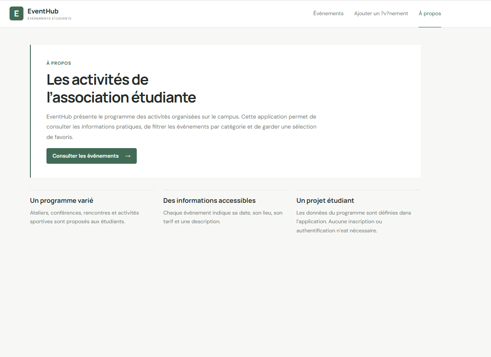
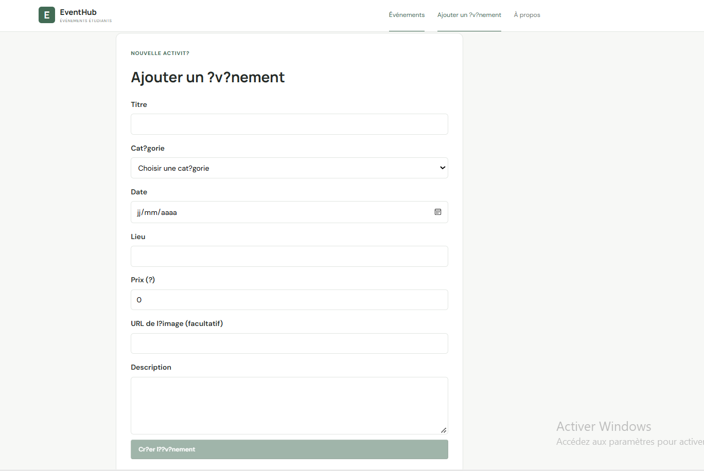
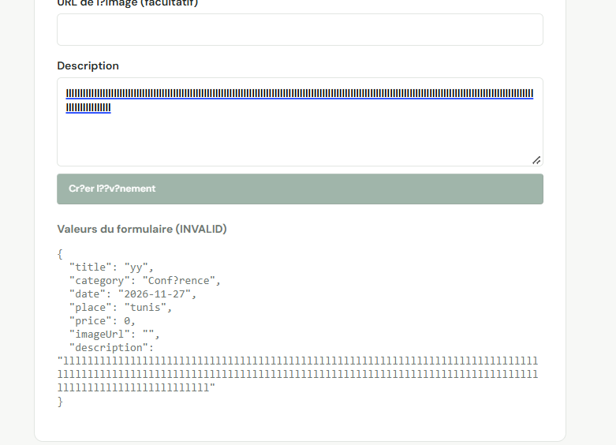

# EventHub

Application web de l’association étudiante pour consulter les activités du campus. Les visiteurs peuvent parcourir les événements, filtrer par catégorie, ajouter des favoris et afficher les détails d’une activité. Le projet fonctionne côté client avec des données définies en TypeScript.

## Technologies

- Angular 21, composants standalone et Angular Router
- TypeScript 5.9
- Signaux Angular pour le filtre et les favoris
- HTML et CSS adaptatif

## Installation

Prérequis : Node.js 20.19 ou version ultérieure et npm.

```bash
npm install
npm start
```

L’application est disponible à l’adresse `http://localhost:4200`. Pour construire la version de production :

```bash
npm run build
```

## Organisation

```text
src/app/
├── about/                 Page de présentation
├── event-card/            Carte d’un événement
├── event-details/         Informations détaillées
├── event-list/            Liste, filtres et favoris
├── header/                En-tête et navigation
├── not-found/             Page d’adresse inconnue
├── app.component.ts       Mise en page principale
├── app.routes.ts          Définition des routes
└── event.model.ts         Type et données des événements
```

## Fonctionnalités

- Six événements dans quatre catégories, dont deux gratuits.
- Filtre de catégorie et message quand aucun événement ne correspond.
- Ajout et retrait des favoris avec compteur.
- Page de détail accessible par `/events/:id`.
- Pages `/events`, `/about` et page d’erreur pour les adresses inconnues.
- Redirection de l’adresse vide vers `/events` et chargement différé des pages.
- Interface adaptée aux écrans d’ordinateur et de téléphone.

## Captures d’écran


### Galerie

#### Liste des ?v?nements



#### Formulaire d?ajout


#### D?tail d?un ?v?nement



#### Favoris


#### Formulaire avec une description trop longue et ses erreurs de validation




Le formulaire affiche sous le champ Description les valeurs saisies au format JSON et le statut de validation (`VALID` ou `INVALID`), mis ? jour en direct.
